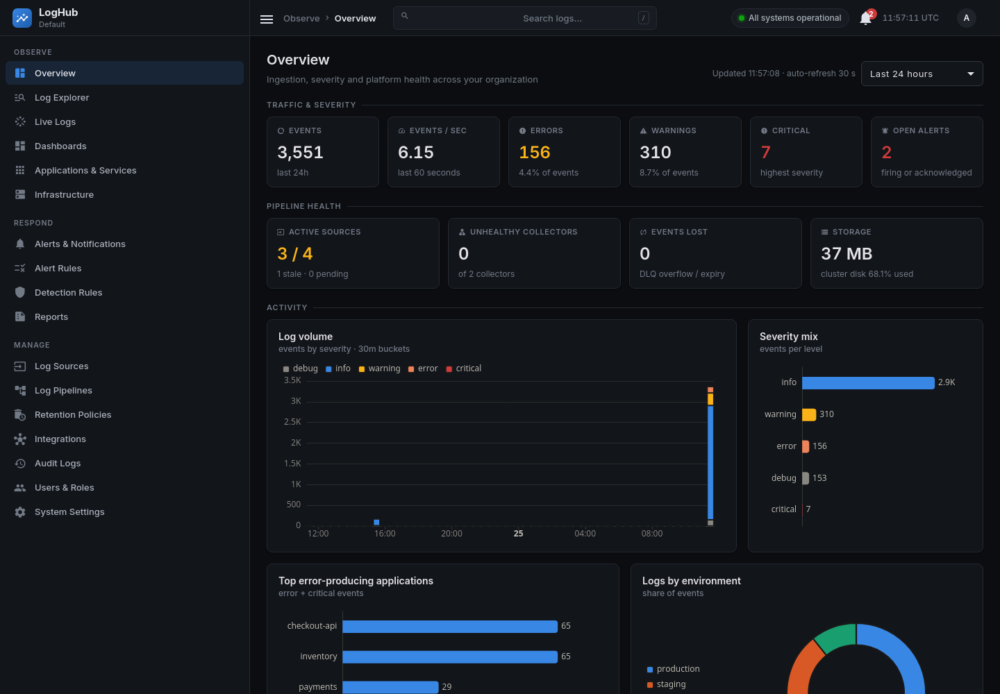
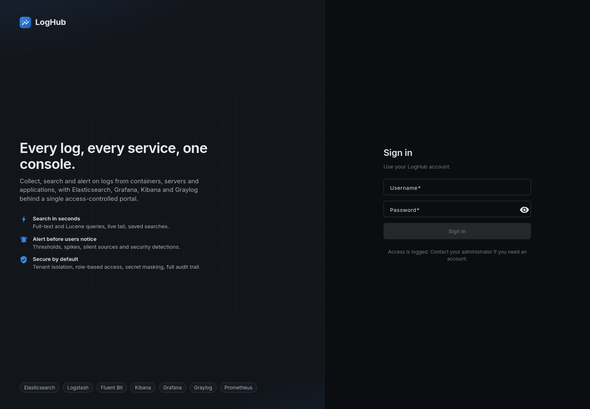
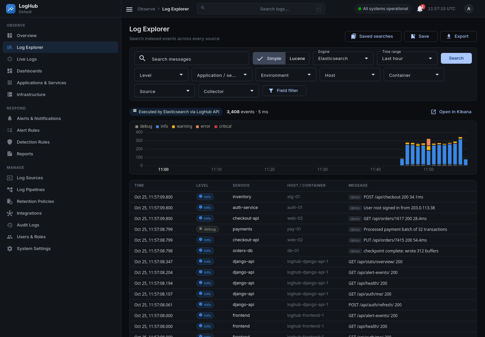
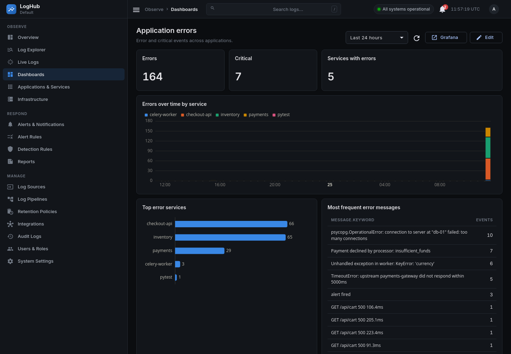

<div align="center">

# LogHub

**Centralized log management and observability platform.**

Collect logs from containers, servers, applications and network devices, then index, search, visualize and alert on them from one access-controlled portal.

[Quick start](#quick-start) · [Screenshots](#screenshots) · [Features](#features) · [Architecture](#architecture) · [Configuration](#configuration) · [Documentation](#documentation)



</div>

LogHub brings Elasticsearch, Logstash, Kibana, Grafana, Graylog, Fluent Bit and Prometheus together behind a Django REST API and an Angular console. Each of those tools stays usable on its own. LogHub adds one login, tenant isolation, alerting and an audit trail on top.

## Table of contents

- [Screenshots](#screenshots)
- [Features](#features)
- [Quick start](#quick-start)
- [Sending logs](#sending-logs)
- [Architecture](#architecture)
- [Portal pages](#portal-pages)
- [Configuration](#configuration)
- [Backup and restore](#backup-and-restore)
- [Development](#development)
- [Project layout](#project-layout)
- [Documentation](#documentation)

## Screenshots

### Sign in

Access is logged. Accounts are created by an administrator, and the first admin is seeded from your `.env`.



### Overview

Traffic and severity, pipeline health (active sources, unhealthy collectors, lost events, storage), log volume by severity, top error-producing applications and logs by environment. The page auto-refreshes every 30 seconds.


### Log Explorer

Simple or Lucene queries, field filters (level, application, environment, host, container, source, collector), a choice of search engine, a volume histogram, saved searches and CSV/JSON export. Each result shows which engine ran the query and links to the same search in Kibana.



### Dashboards

Built-in and custom dashboards of stat, time-series, bar and table widgets, with a time-range picker and a link to the matching Grafana dashboard.



## Features

| Area | What you get |
|---|---|
| **Ingestion** | Fluent Bit collects from Docker (fluentd driver), HTTP JSON, syslog (UDP/TCP) and a per-source token API. Filebeat is supported on a dedicated Logstash input. Events are buffered to disk and routed explicitly to Elasticsearch, Graylog, or both. |
| **Normalization** | Common event schema (`@timestamp`, `level`, `service`, `environment`, `trace_id`, `http.*`, `error.*` and more), grok parsing of access logs, level normalization, secret masking and a fingerprint for idempotent indexing. |
| **Search** | Simple and Lucene queries, field filters, cursor pagination, surrounding events, trace correlation, saved searches, CSV/JSON export, and live tail over Server-Sent Events. |
| **Dashboards** | Custom dashboards in the portal, plus provisioned Grafana dashboards over logs (Elasticsearch) and metrics (Prometheus). |
| **Alerting** | Threshold, spike, silence and disk-usage rules, plus security detections. Deduplication, cooldowns, auto-resolve, and email/webhook delivery with retries. |
| **Multi-tenant security** | Per-organization data streams with enforced query filters, four roles, hashed show-once ingest tokens, PII masking for viewers, and an audit trail for every administrative action. |
| **Retention** | ILM-backed retention policies managed from the portal. |
| **Reports** | Generated reports over a chosen time range. |
| **Operations** | Health checks on every service, a pipeline page backed by the Fluent Bit and Logstash monitoring APIs, a dead-letter replay pipeline, backup/restore scripts and pinned image versions. |

**One pipeline, no duplicates.** Every event carries a `log_route` of `elk` (the default), `graylog` or `both`. Only `both` writes to two stores, and it is an explicit per-source opt-in. Nothing forwards from one store to another, so forwarding loops can't happen.

## Quick start

**Requirements:** Docker with Compose v2, `make`, and about **6 GB of RAM** for the full stack (about 3 GB without Graylog; see [operations](docs/operations.md#resource-requirements)).

```bash
git clone <your-repository-url> loghub
cd loghub

make env     # writes .env with random secrets and prints the admin password
make up      # builds and starts the stack; the first run pulls ~4 GB of images
make demo    # optional: synthetic, clearly labeled demo traffic
```

Open **http://localhost:4200** and sign in as `admin`. The password is `DJANGO_SUPERUSER_PASSWORD` in `.env`.

| Service | URL | Login |
|---|---|---|
| LogHub portal | http://localhost:4200 | `admin` / `DJANGO_SUPERUSER_PASSWORD` |
| API docs (Swagger) | http://localhost:4200/api/docs/ | Bearer token from `/api/auth/login/` |
| Kibana | http://localhost:5601 | `elastic` / `ELASTIC_PASSWORD` |
| Grafana | http://localhost:3000 | `admin` / `GRAFANA_ADMIN_PASSWORD` |
| Graylog | http://localhost:9000 | `admin` / `GRAYLOG_ROOT_PASSWORD` |
| Mailpit (dev email) | http://localhost:8025 | none |

All ports bind to `127.0.0.1` by default. See [Security](docs/security.md) before exposing anything.

Stop the stack with `make down`. Data volumes are kept.

## Sending logs

**HTTP, no setup:**

```bash
curl -X POST localhost:9880 -H 'Content-Type: application/json' \
  -d '{"message":"hello from curl","level":"info","service":"my-app"}'
```

**Token API (per source, tenant-aware):** register a source under **Log Sources**, copy the token (shown once), then:

```bash
curl -X POST http://localhost:4200/api/ingest/ \
  -H "Authorization: Bearer <source-token>" \
  -H 'Content-Type: application/json' \
  -d '{"message":"payment failed","level":"error","service":"checkout-api"}'
```

**Other collectors** are in [examples/](examples/):

| File | Use |
|---|---|
| [fluent-bit-agent.conf](examples/fluent-bit-agent.conf) | Fluent Bit agent on a remote host |
| [filebeat.yml](examples/filebeat.yml) | Filebeat shipping to Logstash `:5044` |
| [rsyslog-loghub.conf](examples/rsyslog-loghub.conf) | Linux syslog forwarding |
| [django_logging.py](examples/django_logging.py) | Python/Django `LOGGING` configuration |
| [docker-compose.logging.yml](examples/docker-compose.logging.yml) | Ship another Compose project's container logs |

Open **Log Explorer** to see the events arrive. Step-by-step instructions are in the [user guide](docs/user-guide.md#ingest-your-first-log).

## Architecture

```
 Docker · HTTP · syslog · token API ──► Fluent Bit ──┬─ elk ──► Logstash ──► Elasticsearch ◄── Kibana · Grafana
                (mask secrets, enforce tenant, route) └─ graylog ─► Graylog ─► OpenSearch + MongoDB
                                                              ▲
             Angular portal ──► Django API (Postgres, Redis) ─┤ search · aggregations · live tail
                                Celery: alert rules, source status, health, retention ─► email / webhooks
```

| Layer | Components | Role |
|---|---|---|
| Collect | Fluent Bit | Gathers, masks, enforces tenant, buffers and routes events |
| Process | Logstash | Parses, enriches, fingerprints; persisted and dead-letter queues |
| Store | Elasticsearch (primary), OpenSearch + MongoDB (Graylog, optional) | One data stream per organization, ILM retention |
| Explore | Kibana, Graylog, Grafana, Prometheus | Native tools for ad-hoc exploration and metrics |
| Platform | Django REST API, Celery, PostgreSQL, Redis | Users, sources, rules, dashboards, audit, search adapters. PostgreSQL holds metadata only, never log payloads. |
| Console | Angular 18, nginx | The portal at `:4200`, with same-origin `/api` |

Graylog runs on its own OpenSearch and MongoDB on an internal-only Docker network, because Graylog 6.1 does not support Elasticsearch 8. Components, design decisions, delivery semantics and known limitations are in **[docs/architecture.md](docs/architecture.md)**.

## Portal pages

| Group | Page | Purpose |
|---|---|---|
| **Observe** | Overview | Traffic, severity and pipeline health at a glance |
| | Log Explorer | Search, filter, save and export logs |
| | Live Logs | Real-time tail over SSE |
| | Dashboards | Custom dashboards, linked to Grafana |
| | Applications & Services | Per-service health and error rates |
| | Infrastructure | Host and collector status |
| **Respond** | Alerts & Notifications | Firing, acknowledged and resolved alerts |
| | Alert Rules | Threshold, spike, silence and disk rules |
| | Detection Rules | Security detections |
| | Reports | Generated reports |
| **Manage** | Log Sources | Register sources, issue ingest tokens |
| | Log Pipelines | Fluent Bit and Logstash status, dead-letter queue |
| | Retention Policies | ILM retention per data stream |
| | Integrations | Elasticsearch, Kibana, Grafana, Graylog, Prometheus health |
| | Audit Logs *(admin)* | Every administrative action |
| | Users & Roles *(admin)* | Accounts, teams, roles |
| | System Settings | Appearance and organization settings |

## Configuration

`make env` creates `.env` from [.env.example](.env.example) and fills every secret with a random value. The settings you are most likely to change:

| Variable | Default | Purpose |
|---|---|---|
| `COMPOSE_PROFILES` | `graylog,metrics` | Optional service groups. Remove `graylog` to save about 2 GB RAM; add `demo` for the generator. |
| `BIND_ADDRESS` / `INGEST_BIND_ADDRESS` | `127.0.0.1` | Interfaces the published ports bind to |
| `PUBLIC_BASE_URL` | `http://localhost:4200` | Used in links and notifications |
| `ES_JAVA_OPTS` / `LS_JAVA_OPTS` | `-Xms768m -Xmx768m` / `-Xms384m -Xmx384m` | Elasticsearch and Logstash heap |
| `EMAIL_HOST` / `EMAIL_PORT` | `mailpit` / `1025` | SMTP relay for alert email. The default is the bundled Mailpit sink. |
| `JWT_ACCESS_TOKEN_LIFETIME_MINUTES` | `30` | Access token lifetime |
| `DEFAULT_ORGANIZATION_SLUG` | `default` | Organization created on first start |

Never commit `.env`. It is already in [.gitignore](.gitignore). The full reference is in [docs/operations.md](docs/operations.md#configuration).

## Backup and restore

```bash
make backup                          # PostgreSQL, Elasticsearch, Grafana, Graylog -> ./backups/<timestamp>
make restore B=backups/<timestamp>   # restore a backup
```

See [operations](docs/operations.md#backup) for what is included and how to schedule it.

## Development

Everything runs in containers. The host needs only Docker and `make`.

```bash
make help               # all tasks
make logs S=logstash    # follow one service's logs
make migrate            # apply database migrations
make migrations         # create migrations after model changes
make shell              # Django shell
make check              # lint (Ruff, angular-eslint) + backend and frontend unit tests, as CI runs them
make test-integration   # end-to-end through the running pipeline
```

| Layer | Stack |
|---|---|
| Backend | Python 3.12, Django 5.1, DRF, Celery, PostgreSQL 16, Redis 7 |
| Frontend | Angular 18 (standalone, signals), Angular Material, ECharts |
| Data plane | Elasticsearch / Logstash / Kibana 8.15.3, Fluent Bit 3.1.9, Grafana 11.2.2, Graylog 6.1.4 + OpenSearch 2.15.0 + MongoDB 7.0, Prometheus 2.54 |
| Quality | 97 backend unit tests + 2 end-to-end tests, 14 frontend tests, Ruff, angular-eslint (including accessibility), ShellCheck, GitHub Actions CI |

Conventions and extension points are in [docs/development.md](docs/development.md).

## Project layout

```
.
├── backend/            Django project
│   ├── accounts/         users, JWT auth
│   ├── organizations/    tenants, teams, environments
│   ├── log_sources/      sources, tokens, ingest endpoint
│   ├── search/           query adapters (Elasticsearch, Graylog), live tail, exports
│   ├── dashboards/       dashboards and widgets
│   ├── alerts/           rules, detections, evaluation
│   ├── notifications/    email and webhook delivery
│   ├── integrations/     Kibana, Grafana, Graylog, Prometheus health
│   ├── retention/        ILM retention policies
│   ├── reports/          report generation
│   ├── audit/            audit trail
│   ├── health/           liveness and readiness
│   ├── demo/             synthetic traffic generator
│   └── tests/            pytest suite
├── frontend/           Angular portal (src/app/pages, core, layout, shared)
├── observability/      Fluent Bit, Logstash, Prometheus, Grafana, bootstrap
├── deploy/             nginx TLS example
├── examples/           collector and application configs
├── scripts/            init-env, backup, restore
├── docs/               guides and screenshots
├── docker-compose.yml  full stack (docker-compose.override.yml adds dev settings)
└── Makefile            developer tasks
```

## Documentation

| Doc | For |
|---|---|
| [Architecture](docs/architecture.md) | Data flow, component ownership, event schema, design decisions, delivery semantics, known limitations |
| [User guide](docs/user-guide.md) | Ingesting, registering sources, searching, dashboards, alerts, retention, reports, roles, API |
| [Operations](docs/operations.md) | Configuration, resource sizing, backup/restore, scheduled jobs, troubleshooting, production deployment |
| [Deployment](docs/deployment.md) | Hosting the API on Render and the console on GitHub Pages |
| [Security](docs/security.md) | Credentials and least privilege, network exposure, masking, query safety, hardening checklist |
| [Development](docs/development.md) | Workflow, quality gates, conventions, extension points, repository layout |

## Troubleshooting

| Symptom | Try |
|---|---|
| Stack is slow or containers restart | You are probably short of RAM. Remove `graylog` from `COMPOSE_PROFILES` and run `make up` again. |
| Portal shows no data | Run `make ps` and check every service is healthy, then send a test event with the `curl` command above. |
| Forgot the admin password | It is `DJANGO_SUPERUSER_PASSWORD` in `.env`. |
| Need a service's logs | `make logs S=<service>` |

More in [docs/operations.md](docs/operations.md#troubleshooting).
